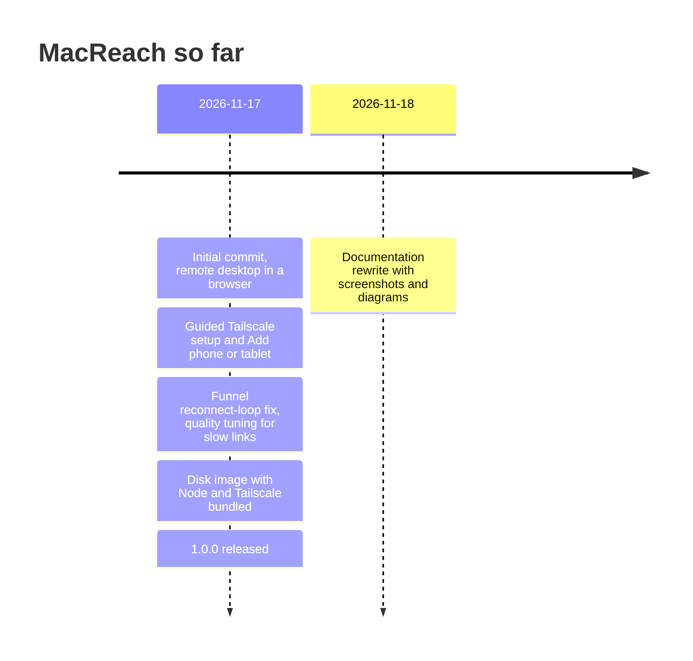

# Changelog

All notable changes to MacReach. The format follows [Keep a Changelog](https://keepachangelog.com/en/1.1.0/), and versions follow [Semantic Versioning](https://semver.org/).

## [Unreleased]

### Changed

- **Documentation rewrite.** Every Markdown file was re-read against the code and rewritten for people who have never seen the project: real screenshots with numbered callouts, diagrams, the quality-controller math, and a new [web client guide](docs/WEB-CLIENT.md). Screenshots use the built-in test pattern and placeholder account details.
- The version shown in the app menu, `macreach-helper --version` and the helper's status message now comes from `VERSION` (through the app's `Info.plist`) instead of a hard-coded "1.0".
- `install.sh` and the docs now require **Node.js 24.7 or newer**, the first release with `crypto.argon2`, which the server uses for password hashing. They previously said 20.

### Fixed

- `install.sh` accepted Node 20 to 24.6 and then failed at the first password hash.
- `macreach help` did not list the `totpOnTailnet` key of `config set`.
- Docs told you to `cd macoanywhere` (the project's earlier name) after cloning.
- Docs named the menu item "Stop MacReach until next login…"; it is **Quit MacReach…**.

### Removed

- Dead code: unused variables and parameters in `server.js`, `hub.js`, `files.js` and `bin/macreach`, and a duplicated branch in the web client's paste handler. No behaviour change.

## [1.0.0] - 2026-11-17

First release. Published as an Apple Silicon disk image, `MacReach-1.0.0-arm64.dmg` (about 54 MB).

### Added

- **Remote control.** Screen capture (ScreenCaptureKit) with hardware H.264 over WebSocket, JPEG fallback, adaptive quality, still-screen refinement. Mouse, touch, keyboard (with Android and iOS IME handling), scroll, clipboard sync, file transfer, multiple displays with hot-plug.
- **Security.** Argon2id login, sessions, CSRF/CSP/Host/Origin checks, rate limits, single controller with takeover, audit log, optional TOTP. The 2FA code is skipped for logins that provably came over your tailnet and always asked for on public (Funnel) logins; `macreach config set totpOnTailnet true` asks everywhere.
- **Tailscale.** Serve (private) and Funnel (public, typed confirmation), pause and kill switches, `macreach doctor` including key-expiry warnings.
- **Menu bar app.** Live "In use" indicator, menu, Settings window, Setup assistant that shows Tailscale sign-in, MagicDNS and HTTPS certificates, the private link, key expiry and an optional **Public access (Funnel)** row. When Funnel is not yet allowed for your account, the app shows Tailscale's approval link. Notifications, app icon, `macreach://settings|setup|add-device` deep links, a single running instance, a Dock icon while a window is open.
- **"Add phone or tablet"** window: app-store links, QR code of the private link, device list.
- **Disk image.** `scripts/make-dmg.sh` builds `dist/MacReach-<version>-arm64.dmg`, a self-contained app (helper, server, web client, Node 24 and Tailscale inside; about 54 MB download, 157 MB installed). Opening the app from Finder sets up the three background jobs from the app itself, refuses to do so from a disk image or a translocated path, clears quarantine on itself, and re-runs on an update or a move. Also: **Uninstall MacReach…** in the menu, `installed.json` bookkeeping, a `VERSION` file, license notices in the app, `scripts/backup-signing-key.sh`, and [docs/RELEASING.md](docs/RELEASING.md).
- **CLI and install.** `install.sh` one-shot installer, auto-start at login, log rotation, clean `uninstall [--purge]`.
- **Web.** A toolbar button for Mission Control. On a slow path (smoothed round trip over 120 ms) the browser draws its own pointer so it moves instantly.

### Changed

- **Latency.** The in-flight byte budget is time-based (acknowledged rate × (round trip + 150 ms)), and keyframes are requested only after the queue has drained and back off while they keep coming (400 ms doubling to 3.2 s). In a simulated 1.5 Mbps / 400 ms link the worst send-to-ack time fell from 5.2 s to 0.7 s, and a window-opening scene needed 5 keyframes instead of 13.
- **Quality ladder.** The two lowest rungs are probed after 8 s instead of 15 s, up to 20 frames may be in flight on slow relay paths (Funnel), and a refreshed session resumes at the level it had earned.

### Fixed

- Reconnect loop over Funnel: the liveness deadline was 500 ms and is now 25 s.
- Pause, kill and `funnel off` no longer run `tailscale funnel reset`, which also wiped the private link.
- The device list in "Add a phone or tablet" showed dozens of Funnel relay peers (`funnel-ingress-node`); only your own devices are listed now.

### Known limits

- Not notarized, so the first launch needs **Open Anyway**.
- Apple Silicon only for the disk image; Intel Macs build from source.
- Real iOS and iPadOS Safari have not been tested.
- A locked screen, closed lid, sleeping Mac or the login window cannot be controlled remotely.

[Unreleased]: https://github.com/VarunMatta5625/macreach/compare/v1.0.0...HEAD
[1.0.0]: https://github.com/VarunMatta5625/macreach/releases/tag/v1.0.0
