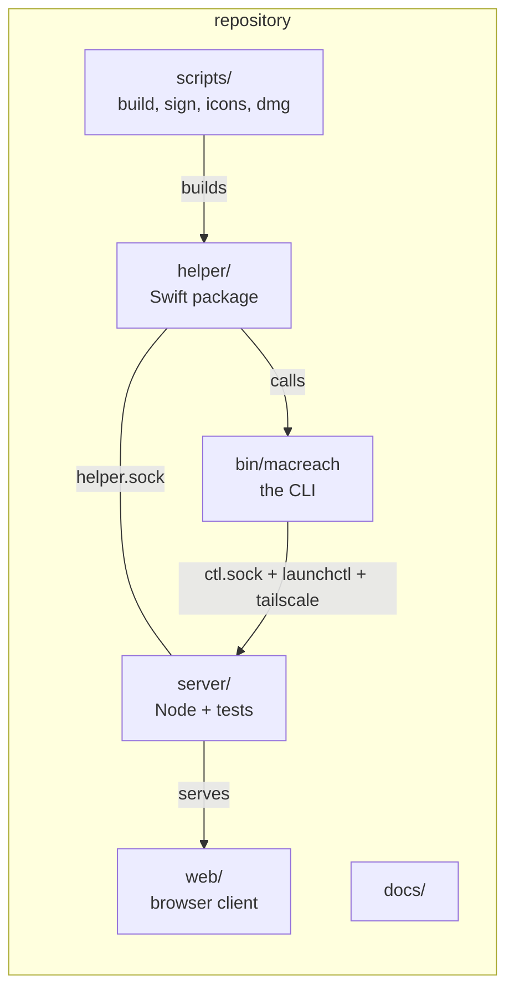

# Contributing

Thanks for looking. MacReach is small on purpose: one Swift app, one Node server with one dependency, and a browser client with no build step. Please keep it that way.

## The map



| Path | What |
| --- | --- |
| `helper/` | Swift package: capture, encode, input, clipboard, menu bar app, Settings, Setup assistant |
| `server/` | Node server and its tests |
| `web/` | Browser client: vanilla ES modules, no build step |
| `bin/macreach` | The CLI, and the **single owner** of pause, Funnel, config and install logic. UI code calls it instead of re-implementing |
| `scripts/` | Build, signing, icon and disk-image scripts |
| `docs/` | Setup guide, web client guide, architecture, release guide, engineering log, and `images/` |

Read [docs/ARCHITECTURE.md](docs/ARCHITECTURE.md) first. It explains how the pieces talk.

## Where do I change…?

| I want to change | Edit |
| --- | --- |
| Touch and mouse thresholds, reconnect timing | `web/app/js/config.js` |
| The quality ladder or the controller | `LADDER` and `QualityController` in `server/src/quality.js` (and its simulator test) |
| Login limits, timeouts, defaults | `DEFAULTS` in `server/src/config.js` |
| A menu bar label or item | `helper/Sources/MacReachHelper/StatusItem.swift` |
| A Setup or Settings row | `Checklist` in `helper/Sources/MacReachHelper/Windows.swift` |
| A new CLI command | the `commands` object **and** the `help` text in `bin/macreach` |
| A new command the server sends to the helper | `onCommand` in `helper/.../main.swift`, plus `server/src/hub.js` |
| A security header | `securityHeaders` in `server/src/server.js` (and the e2e test that checks it) |

## Working on it

Requirements: macOS 14+, Xcode Command Line Tools with **Swift 6**, **Node.js 24.7+**, and `npm ci` once in `server/`.

```sh
scripts/build-helper.sh && macreach install   # rebuild the app, redeploy, restart the background jobs
cd server && node --test test/*.mjs           # 32 tests, must stay green
macreach doctor                               # health check after changes
```

The server runs from a copy in `~/Library/Application Support/MacReach/runtime`, **not** from the repo, because macOS privacy rules stop launchd reading `~/Desktop`. So run `macreach install` after every change.

### A safe test setup (never touches your live Mac)

```sh
mkdir -p /tmp/mr /tmp/mrdata        # short paths: Unix socket paths must be under 104 characters
# 1. A helper that draws a test pattern and logs input instead of injecting it. A custom --socket also means: no menu bar item.
/Applications/MacReach.app/Contents/MacOS/MacReach --test-pattern --socket /tmp/mr/h.sock &
# 2. The server, on its own port, data folder and sockets
MACREACH_DATA_DIR=/tmp/mrdata MACREACH_CTL_SOCK=/tmp/mr/ctl.sock \
MACREACH_HELPER_SOCK=/tmp/mr/h.sock MACREACH_PORT=7879 node server/src/index.js
```

Create throwaway credentials with `hashPassword()` from `server/src/password.js` written into `/tmp/mrdata/auth.json` (never your real password). Then open <http://localhost:7879/>.

Test-only knobs: `--input-log FILE` (what input arrived), `--real-clipboard` (use the real pasteboard, snapshot and restore yours first), `kill -USR1 <pid>` (toggle between 1 and 3 simulated displays), and the environment variables `MACREACH_TEST_DISPLAYS` and `MACREACH_TEST_STATIC=N`.

## Rules of the house

- **Secrets are only ever typed in a terminal.** No GUI password fields, and no secrets in arguments or environment variables.
- **Never run test input against your live Mac.** Use the test helper above.
- Tests use a throwaway data directory (`MACREACH_DATA_DIR`). `macreach install` refuses to run with it set.
- **Do not turn on Funnel from code or tests.**
- **Dependencies stay at zero beyond `ws`.** The web client has no build step and no framework.
- **Node 24.7+** is a hard floor (`crypto.argon2`). If you raise it, change `install.sh`, `scripts/make-dmg.sh` and every doc that names it.
- Commit messages: a short imperative subject, and the *why* in the body.

## Documentation

- Keep a doc and the code it describes in the same change. When behaviour changes, update the README, the guide that covers it, and the [CHANGELOG](CHANGELOG.md).
- **Screenshots must not contain real data.** Use the test setup above, or replace usernames, account emails, tailnet addresses, device names and QR codes with placeholders (`demo`, `you@example.com`, `node-1a2b3c.tail1234.ts.net`). Images live in `docs/images/`.
- Diagrams are Mermaid or SVG so they stay editable. Math uses GitHub's `math` blocks.
- Say what is **not** verified. [docs/DEVLOG.md](docs/DEVLOG.md) keeps a list.

## Security issues

Do not open a public issue. See [SECURITY.md](SECURITY.md#reporting-a-vulnerability).
