<div align="center">


<br>

[](https://github.com/VarunMatta5625/macreach/releases/latest)


-ff9f0a?style=flat-square)


**Control your own Mac from a phone, a tablet or another computer. The device needs only a browser.**

[Install](#install) · [First 10 minutes](#first-10-minutes) · [How it works](#how-it-works) · [Security](#security) · [Docs](#documentation-map)

</div>

---

## At a glance

A small native menu bar app captures your screen and injects mouse, keyboard and clipboard input. A tiny Node server (one dependency, [`ws`](https://github.com/websockets/ws)) streams hardware H.264 over a WebSocket to a plain JavaScript web client. [Tailscale](https://tailscale.com) carries it: **private to your own devices by default, public only if you explicitly turn it on.**

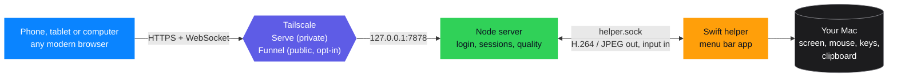

<p align="center">
  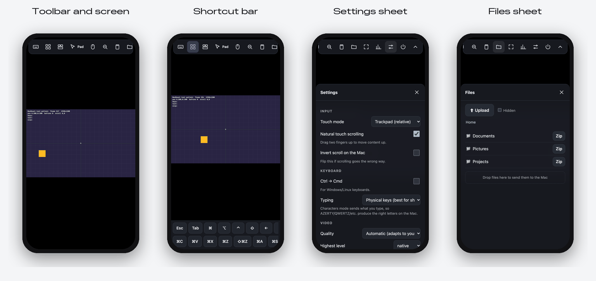
</p>

> [!NOTE]
> The screen in these screenshots is MacReach's built-in **test pattern**, used so that no real desktop appears in the documentation. On your phone you see your Mac.

## Features

| | |
| --- | --- |
| **Control** | Mouse, trackpad and touch (two touch modes), a full keyboard with a path for phone keyboards and emoji, scrolling with momentum, pinch zoom, clipboard sync (text and images), file browsing and transfer, several displays with hot-plug. |
| **Video** | ScreenCaptureKit capture, VideoToolbox hardware H.264 decoded by WebCodecs, JPEG fallback, a six-rung [quality ladder](docs/ARCHITECTURE.md#the-quality-controller) that adapts to your connection, and a sharp refinement frame when the screen goes still. |
| **Visible on the Mac** | The menu bar icon turns red with "In use" while someone controls the Mac. An optional notification says which device connected. The Mac stays awake during a session. |
| **Security** | Argon2id password typed only in your own Terminal, sessions with CSRF, CSP, Host and Origin checks, rate limits and lockout, one controller at a time, audit log, optional TOTP, a pause switch and a kill switch. See [SECURITY.md](SECURITY.md). |
| **Guided and repeatable** | A Setup assistant covers permissions, password and Tailscale. "Add phone or tablet" shows a QR code of your private link. Re-open either from the menu bar at any time. |
| **Installable web app** | Use "Add to Home Screen" on iOS or Android for a full-screen app (it appears as "Remote"). |

## Install

There are two ways in. The disk image is for almost everyone.

### Option A: the disk image (no developer tools)

1. Download `MacReach-<version>-arm64.dmg` from the [latest release](https://github.com/VarunMatta5625/macreach/releases/latest). It is about 54 MB and carries its own Node.js and Tailscale.
2. Open it, drag **MacReach** into **Applications**, eject the image, then open MacReach.
3. macOS blocks the first launch because the app is **not notarized** (that needs a paid Apple developer account). This happens once:

<p align="center">
  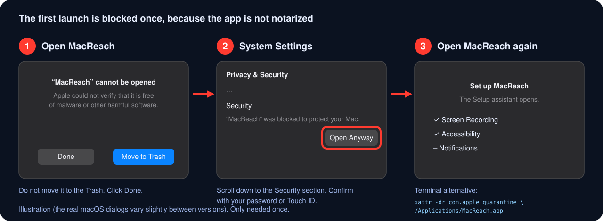
</p>

   Terminal alternative: `xattr -dr com.apple.quarantine /Applications/MacReach.app`.
4. The **Setup assistant** opens. Follow it ([next section](#first-10-minutes)).

**Requirements:** an Apple Silicon Mac (M1 or later) on macOS 14 or newer.

<details>
<summary><b>Updating, removing, firewall prompt, building the image yourself</b></summary>

- **Update:** download the new image, drag the app over the old one, open it once. It re-registers its background jobs by itself.
- **Remove:** menu bar icon > **Uninstall MacReach…**. It moves the app to the Trash and keeps your password and settings so a reinstall picks up where you left off. `macreach uninstall --purge` deletes those too.
- **Firewall:** with the macOS firewall on, the first start may ask whether `tailscaled` may accept incoming connections. Click **Allow**. If you click Deny, Tailscale still works through its relay servers, only slower.
- **Build the image yourself:** [docs/RELEASING.md](docs/RELEASING.md).

</details>

### Option B: build from source (Apple Silicon or Intel)

You need macOS 14+, Xcode Command Line Tools with **Swift 6**, and **Node.js 24.7 or newer** (the server uses `crypto.argon2`, which first shipped in Node 24.7). Tailscale is optional and is installed with Homebrew.

```sh
git clone https://github.com/VarunMatta5625/macreach.git
cd macreach
./install.sh              # add --no-tailscale to skip Tailscale (then MacReach only works on this Mac)
```

`install.sh` is safe to re-run: every step that is already done is skipped. It checks your tools, installs `ws` and Tailscale, builds and signs the app, starts the three background jobs and opens the Setup assistant.

## First 10 minutes

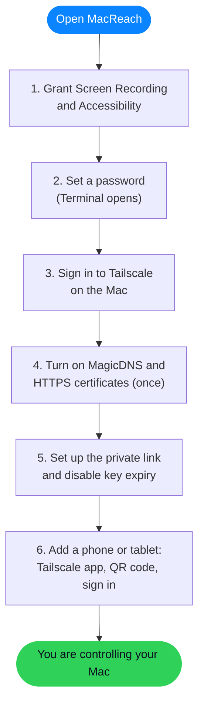

The Setup assistant shows live ticks for every step, so you always see what is left:

<p align="center">
  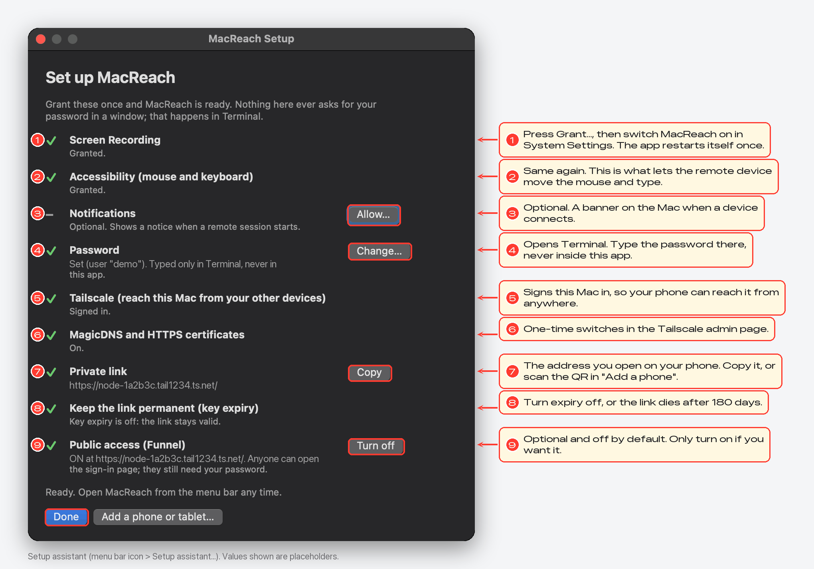
</p>

Then press **Add a phone or tablet…** and follow the four steps in that window:

<p align="center">
  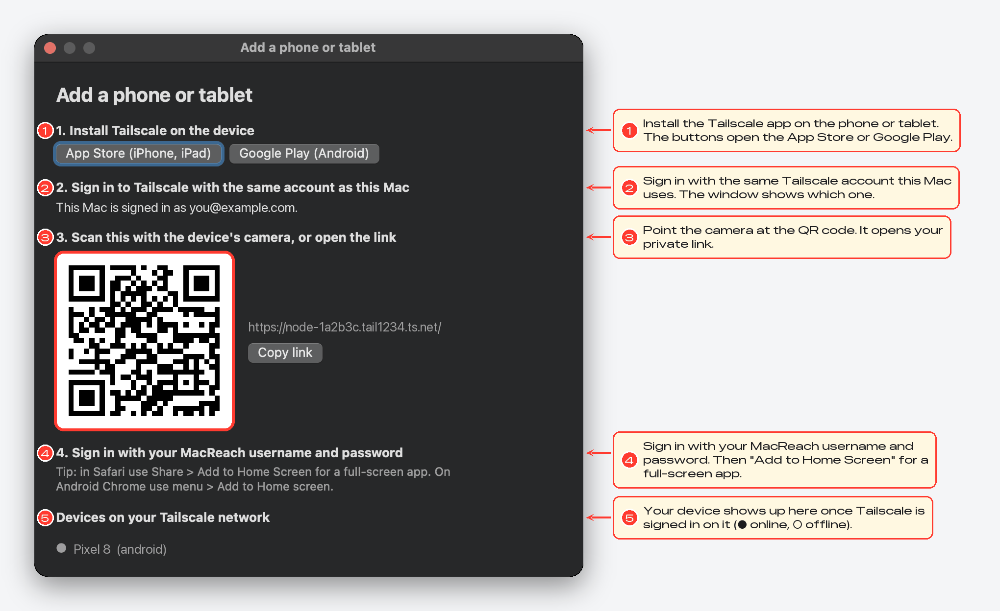
</p>

Every step, with checks and fixes, is in the [setup guide](docs/SETUP.md).

> [!IMPORTANT]
> **Turn off key expiry for this Mac** in Tailscale's admin page (machine menu > Disable key expiry). Otherwise Tailscale signs it out after 180 days and your link stops working. `macreach doctor` warns when fewer than 30 days remain.

## Using it

<table>
<tr>
<td width="50%">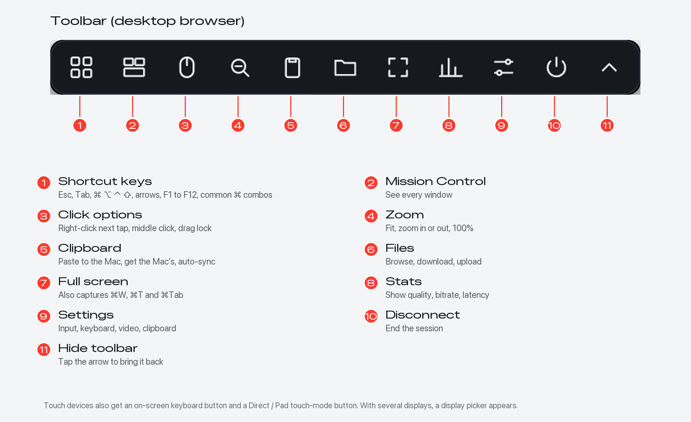</td>
<td width="50%">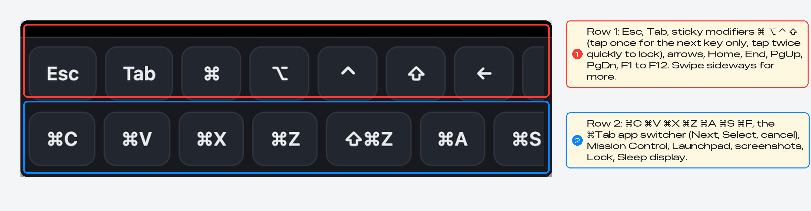</td>
</tr>
<tr>
<td align="center"><sub>The toolbar. Every button is numbered and explained.</sub></td>
<td align="center"><sub>The shortcut bar for ⌘ combos and function keys.</sub></td>
</tr>
</table>

More screens, gestures and the sign-in flow are in the [web client guide](docs/WEB-CLIENT.md).

Day to day, use the menu bar icon or the command line:

```sh
macreach doctor          # health check with a fix for every red line
macreach card            # your URLs and the pause / kill commands
macreach access pause    # refuse all remote access (resume with: macreach access resume)
macreach help            # everything else
```

<p align="center">
  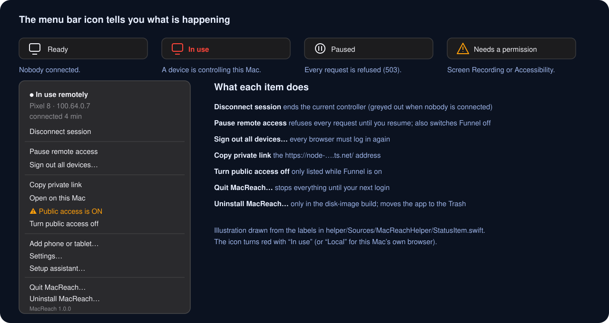
</p>

## How it works

Two processes on your Mac talk over a private Unix socket: the **Swift helper** (capture, encode, input, clipboard, menu bar UI) and the **Node server** (login, sessions, the web client, quality control). Tailscale puts the server on your private network. Nothing listens on a public port.

<p align="center">
  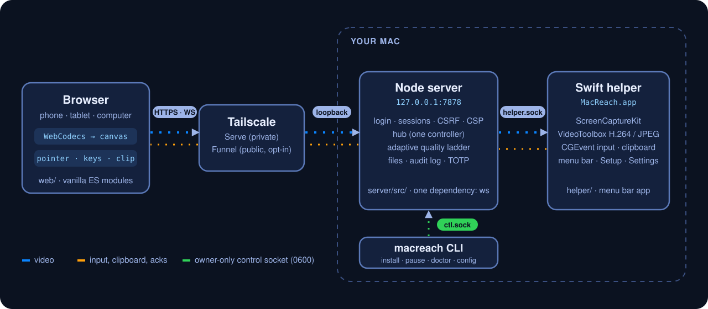
</p>

Video has to stay responsive on a slow link, so the server never lets a queue build up. It measures the round trip and the rate the browser actually acknowledges, and caps the bytes in flight to what the path can carry in one round trip plus 150 ms:

```math
B_{\max} \;=\; \max\!\Big(B_{\text{floor}},\ \min\big(B_{\text{ceil}},\ \hat r \cdot (\mathrm{RTT}_{\min} + 0.15\,\mathrm{s})\big)\Big)
```

When a frame would exceed that budget it is dropped, the stream waits for the next keyframe, and the level steps down the ladder. When the link is calm it climbs back up.

<p align="center">
  
</p>

The derivations, the sequence of a login and the wire format are in [docs/ARCHITECTURE.md](docs/ARCHITECTURE.md).

## Security

MacReach gives whoever signs in full control of your Mac, so it is private by default:

- The server listens on `127.0.0.1` only. Remote reach comes from Tailscale Serve (your tailnet) or, if you opt in, Funnel (the public internet; a visitor sees only the sign-in page until they sign in).
- The password is read only from your own Terminal, with echo off, and stored as an Argon2id hash.
- Wrong guesses are throttled before any hashing happens; eight failures from one address lock it out for 15 minutes.
- One controller at a time, and the menu bar icon turns red while a session is live.
- A pause switch, a kill switch and an audit log are always one command away.

> [!WARNING]
> Public access (Funnel) is **off by default**. Turning it on lets anyone on the internet reach your sign-in page. It requires a password and a typed `go public` confirmation, and the two-factor code is then always required if you enabled it. Read [SECURITY.md](SECURITY.md) first.

## Known limits

> [!NOTE]
> - A **locked screen, a closed lid, a sleeping Mac or the login window** cannot be controlled remotely. That is a macOS limit.
> - macOS periodically asks you to re-approve Screen Recording. If the remote screen turns black, approve the prompt on the Mac.
> - **Tested with** Chrome, Android Chrome and Playwright's WebKit (iPhone and iPad profiles). Real iOS and iPadOS Safari has **not** been tested yet.
> - The disk image is Apple Silicon only. Intel Macs can build from source.

## Development

```sh
cd server && npm ci && node --test test/*.mjs   # 32 server tests
scripts/build-helper.sh                          # build and sign ~/Applications/MacReach.app
macreach install                                 # deploy the server copy and restart the background jobs
```

See [CONTRIBUTING.md](CONTRIBUTING.md) for the rules of the house.

## Documentation map

| Read this | When |
| --- | --- |
| [docs/SETUP.md](docs/SETUP.md) | You are installing and want every step with a check |
| [docs/WEB-CLIENT.md](docs/WEB-CLIENT.md) | You want to know every button, gesture and setting of the browser client |
| [docs/ARCHITECTURE.md](docs/ARCHITECTURE.md) | You want the design, the protocol and the math |
| [SECURITY.md](SECURITY.md) | You want to know what protects the Mac and how to stop access |
| [CHANGELOG.md](CHANGELOG.md) | You want to know what changed between versions |
| [docs/RELEASING.md](docs/RELEASING.md) | You build the disk image or publish a release |
| [CONTRIBUTING.md](CONTRIBUTING.md) | You want to change the code |
| [docs/DEVLOG.md](docs/DEVLOG.md) | You want the engineering history and the reasons behind decisions |
