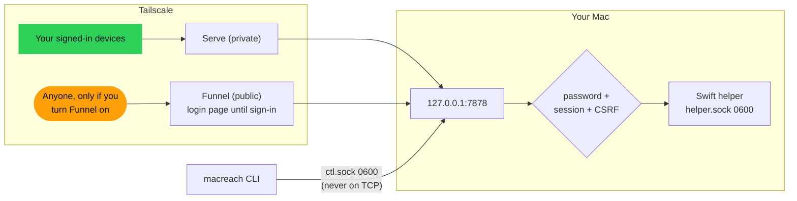
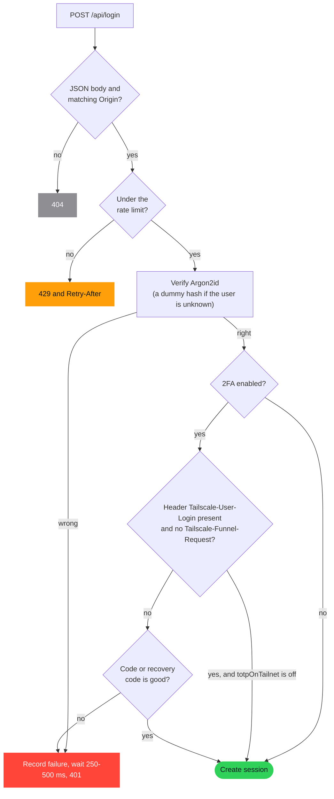

# Security

MacReach gives whoever signs in **full control of your Mac**, including your files under the allowed folders. So it is built to be private by default and to be stopped in one step.

> [!IMPORTANT]
> Treat your MacReach password like your Mac's login password. Use a long random passphrase, keep **public access (Funnel) off** unless you need it, and turn on two-factor if you do.

## The picture



## What protects what

| Layer | What it does |
| --- | --- |
| **Network** | The server binds `127.0.0.1` only. Remote reach comes from Tailscale Serve (your tailnet) or, if you opt in, Funnel (public internet; a visitor sees only the login page **until they sign in**, and then has full control). |
| **Password** | Argon2id (64 MiB memory, 3 passes, 4 lanes, 32-byte hash) in a `0600` file. At least 12 characters. Read only from your own Terminal with echo off, never from arguments, environment, pipes or any GUI. |
| **Brute force** | Checked **before** any hashing, so floods cannot burn CPU. See the table below. A wrong login also waits a random 250 to 500 ms. |
| **Sessions** | Cookie `mr_sid`: `HttpOnly`, `SameSite=Strict`, `Secure` behind HTTPS. The server stores only a SHA-256 of the cookie in a `0600` file, so the file holds no usable cookies. Idle timeout 30 minutes and absolute timeout 12 hours (both settable). |
| **Requests** | Every state-changing request needs the session's CSRF token **and** a matching `Origin`. HTTP and WebSocket both check `Host` and `Origin`. |
| **Browser hardening** | Strict `Content-Security-Policy` (scripts and styles from `self` only, no framing), `X-Frame-Options: DENY`, `nosniff`, `Referrer-Policy: no-referrer`, `Cross-Origin-Opener-Policy` and `Cross-Origin-Resource-Policy` set to same-origin, `Permissions-Policy`, HSTS over HTTPS, `Cache-Control: no-store`. |
| **One controller** | Only one device controls the Mac at a time. A second device can take over only if allowed in Settings (default: allowed). |
| **Two-factor (optional)** | TOTP (SHA-1, 6 digits, 30 s, one step of clock drift either way). A code works **once**, even under parallel requests. 10 single-use recovery codes, stored hashed. A recovery-code login posts a notification on the Mac. |
| **Control socket** | `pause`, `kick`, `revoke-all`, `reload` are served only on a `0600` Unix socket (`ctl.sock`), never on the TCP port that tunnels reach. |
| **Self view** | A browser on the Mac itself cannot inject input unless you opt in. |
| **Public access** | Turning on Funnel needs the typed phrase `go public` and is refused when no password is set. |
| **Audit log** | `audit.log` records logins (with the reason for failures), control start and end, takeovers, lockouts, uploads, access changes, config changes, password and 2FA changes. Rotated at 5 MB. |

### Brute-force limits

| Limit | Value |
| --- | --- |
| Per address | 8 failures within 15 minutes lock that address for 15 minutes |
| Backoff before the lock | From the third failure in a row, the next try waits $`2^{n-2}`$ seconds, capped at 60 |
| All addresses together | 30 failures within 10 minutes lock **everyone** for 5 minutes |
| On a lock | A notification appears on the Mac ("Remote access locked out") |

Because a global lock can only be followed by another 30 guesses after it ends, the most an attacker can try in a day, from any number of addresses, is

```math
\frac{30\ \text{guesses}}{5\ \text{min}} \times 1440\ \text{min/day} \;=\; 8\,640\ \text{guesses per day}
```

A random passphrase of four words from a 7 776-word list has $`7776^4 \approx 3.7\times10^{15}`$ possibilities, so even guessing for the whole space would take on the order of $`10^{11}`$ days. A weak, guessable password is the one thing this arithmetic cannot save you from.

## Two-factor code and the private link



The code is only requested when a login **cannot prove it came over your tailnet**. Tailscale Serve removes any client-supplied `Tailscale-User-*` header and adds its own only for tailnet traffic. Public Funnel traffic carries none and is marked `Tailscale-Funnel-Request`. So Funnel and local logins always need the code. The password is always required. A tailnet login by someone you shared the Mac with counts as tailnet.

Turn the exemption off with `macreach config set totpOnTailnet true`.

## What a signed-in person can do

Be clear about this when you decide who gets the password:

- See and control the whole screen, type anything, and use the clipboard.
- **Browse and download files** under the allowed folders (your home folder by default), including whole folders as a zip. Paths are resolved to their real location and must stay inside an allowed folder, so symlinks and `..` cannot escape.
- **Upload files** (up to 20 GB each), by default to `~/Downloads/MacReach`. Names are cleaned and never overwrite an existing file.
- Lock the screen or put the display to sleep.

MacReach has no web page or API for changing its own password, settings or Tailscale. But **screen control means they can do anything you can do at the keyboard**, including opening Terminal and running `macreach set-password`, `macreach access funnel` or any other command. Giving someone the password is giving them your Mac.

## Stopping access

| Action | How |
| --- | --- |
| Disconnect the current session | menu bar > **Disconnect session**, or `macreach kick` |
| Pause everything (reversible) | menu bar > **Pause remote access**, or `macreach access pause` |
| Sign out every device | menu bar > **Sign out all devices…**, or `macreach revoke-all` |
| Turn public access off | menu bar > **Turn public access off**, or `macreach access funnel off` |
| Kill everything | `macreach access kill` (stops the server and Tailscale daemon, stays paused after a reboot) |
| Away from the Mac | Tailscale admin console > Machines > disable Funnel or remove the machine |

**Pause** refuses every request with a 503, disconnects the controller and turns Funnel off. It does not touch your private Serve link, so resuming is instant.

## Things to know

- **Tailscale machine name:** it appears in public certificate transparency logs, so MacReach picks a neutral random name (`node-xxxxxx`).
- **Key expiry:** Tailscale node keys expire after 180 days. Disable key expiry for this machine so the link keeps working. This is reliability, not security: an expired key cuts access, it never widens it.
- **Signing and notarization:** the app is signed with a self-signed certificate kept in a dedicated keychain, so macOS permission grants survive updates. It is **not notarized**, which is why the first launch needs **Open Anyway**. The disk image bundles Node.js (MIT), Tailscale (BSD-3-Clause) and `ws` (MIT); their licenses are inside the app.
- **Client addresses behind Funnel:** per-address limits need the real client address. `macreach doctor` checks that Tailscale passes it on.
- **Lost phone:** sign out all devices, then change the password (`macreach set-password` also signs everything out).

## Reporting a vulnerability

Open a private security advisory on this repository (**Security** tab > **Report a vulnerability**), or contact the maintainer directly. Please do not file public issues for vulnerabilities.
