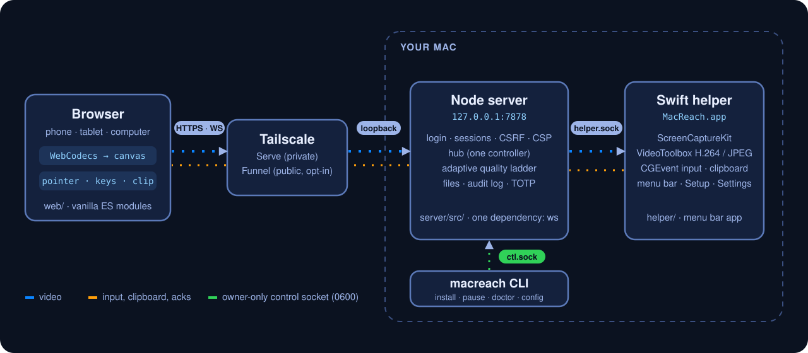
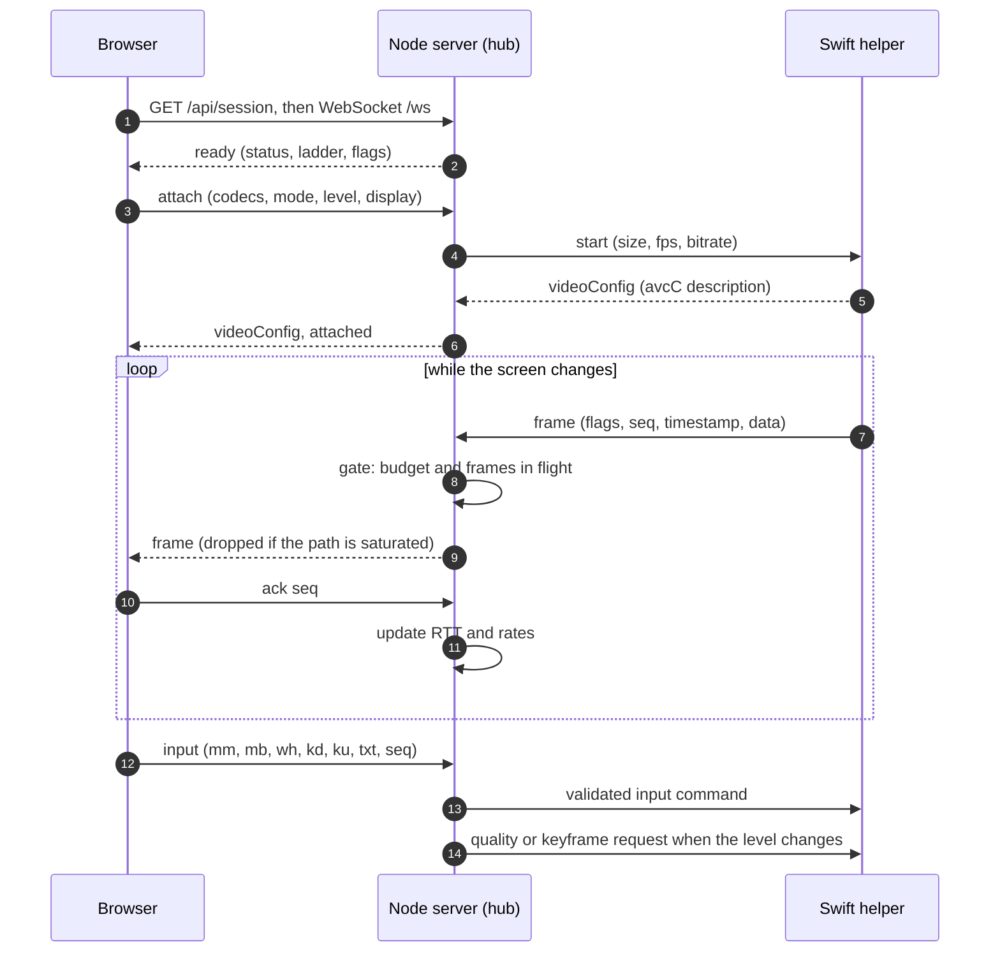
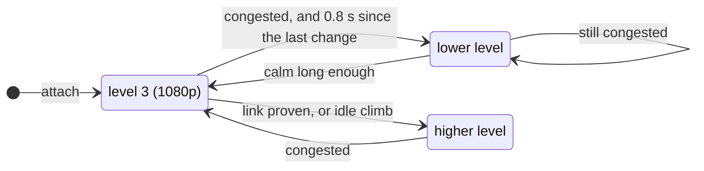
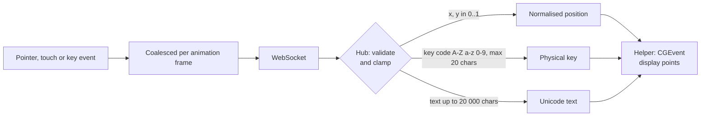
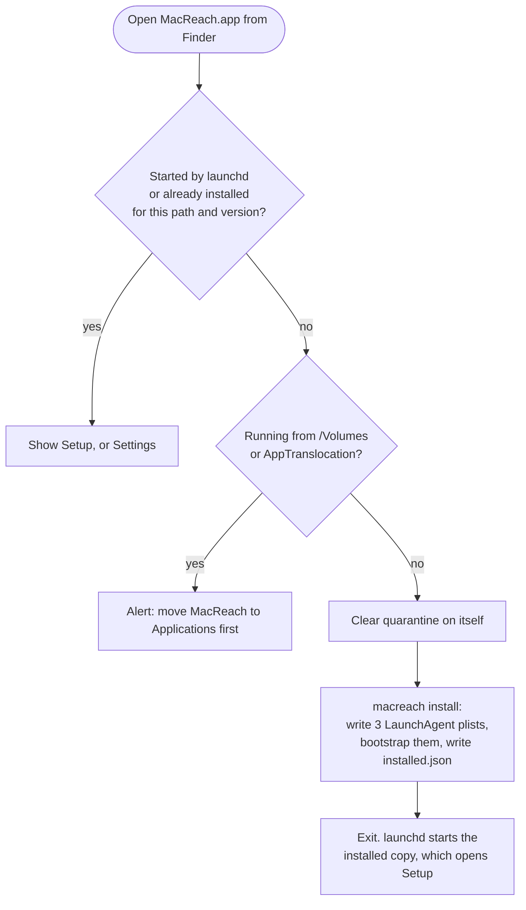

# Architecture

How MacReach is put together, how bytes move, and the arithmetic that keeps the picture responsive.

<p align="center">
  
</p>

## The parts

| Part | Language | Runs as | Job |
| --- | --- | --- | --- |
| **Swift helper** `helper/` | Swift 6 (language mode 5) | `MacReach.app`, a LaunchAgent (`com.macreach.helper`, `LSUIElement`) | Capture, encode, inject input, clipboard, power assertions, menu bar item, Setup, Settings, notifications |
| **Node server** `server/src/` | JavaScript, one dependency (`ws`) | LaunchAgent `com.macreach.server`, binds `127.0.0.1:7878` | Login, sessions, the web client, the single controller, adaptive quality, files, audit log |
| **Web client** `web/` | Vanilla ES modules, no build step | The browser | WebCodecs decode to a canvas, pointer / touch / keyboard, settings sheet |
| **CLI** `bin/macreach` | Node | You, or the helper's UI | The single owner of install, pause, Funnel, config and `doctor`. UI code calls it instead of re-implementing |
| **Tailscale daemon** | Go (upstream) | LaunchAgent `com.macreach.tailscaled`, rootless userspace networking | Puts the server on your tailnet (Serve) or the internet (Funnel) |

All three LaunchAgents run in the user's GUI session with `RunAtLoad` and `KeepAlive`, restart 5 s after an exit, and name the app as their owner (`AssociatedBundleIdentifiers`) so **System Settings > Login Items** shows "MacReach" rather than bare `node` and `tailscaled`.

## One frame, end to end



The helper sends **nothing while the screen is static**. After 400 ms of stillness it re-sends the last frame as one sharp keyframe (the *refinement*), so a still screen ends up crisp.

## Wire formats

### Helper link (`helper.sock`, a `0600` Unix socket)

Every message is a frame: `[1 B type][4 B big-endian length][payload]`.

| Type | Direction | Payload |
| --- | --- | --- |
| `0x01` | helper to server | JSON (`status`, `videoConfig`, `display`, `clip`, `streamError`…) |
| `0x02` | helper to server | Video frame (below) |
| `0x10` | server to helper | JSON command (`start`, `quality`, `keyframe`, `mm`, `mb`, `wh`, `kd`, `ku`, `txt`, `rel`, `clipset`, `session`…) |

The helper accepts **one client at a time**; a new connection replaces the old one. The CLI never connects to it, it uses `ctl.sock` on the server.

### Video frame (type `0x02`)

| Bytes | Field |
| --- | --- |
| 0 | Flags: bit 0 = keyframe, bit 1 = JPEG |
| 1 to 4 | Sequence number, big-endian |
| 5 to 12 | Monotonic timestamp in microseconds, big-endian |
| 13… | H.264 (AVCC) or JPEG data |

The server forwards the same bytes to the browser as one binary WebSocket message. The browser acknowledges by sending the sequence number back as JSON.

### Browser connection (`/ws`)

Text frames are JSON with a `t` field; binary frames are video. Close codes the client treats as final: `4001` taken over, `4002` expired, `4003` ended, `4004` replaced by the same login, `4005` busy with takeover off. Anything else reconnects after 0.5 s, doubling to 8 s.

Liveness: the browser pings every 2 s; the server pings every 5 s and counts **any** message as proof of life. It drops a client after **25 s** of silence. (The deadline was once 0.5 s, which made Funnel sessions reconnect forever, because a pong waits behind the video already queued on the same TCP stream.)

## Video

- **Capture:** ScreenCaptureKit, one source per display, with a hot-plug observer. If the chosen display disappears the helper falls back to the main one and restores your choice when it returns.
- **Encode:** VideoToolbox H.264, High profile, real-time, **no B-frames**, a keyframe at least every 30 s and on demand. A JPEG encoder is the fallback.
- **SPS patch (`server/src/h264.js`):** VideoToolbox's SPS lacks `bitstream_restriction`, so browser decoders assume frame reordering and hold frames back. The server rewrites the SPS inside the `avcC` description to declare zero reordering, and frames then appear immediately (about 1.6 ms decode).
- **Decode:** WebCodecs `VideoDecoder`, configured from `avc1.640032`, `avc1.64002a` or `avc1.42e01f`, whichever the browser supports. Everything is decoded in order, **only the newest frame is painted**, and nothing is queued. If the decoder refuses, the client re-attaches with JPEG.
- **Identical `videoConfig`s are ignored.** The helper repeats it with every keyframe; tearing the decoder down each time starved Android hardware decoders.

## The quality controller

One `QualityController` per attached client (`server/src/quality.js`). *Principle: latency beats smoothness. Never queue; when the path is saturated, drop to the next keyframe and step down.*

### The ladder

| Level | Name | Size cap | fps | Target bitrate |
| --- | --- | --- | --- | --- |
| 0 | `saver` | 960×600 | 15 | 0.9 Mbps |
| 1 | `low` | 1280×800 | 24 | 2 Mbps |
| 2 | `medium` | 1600×1000 | 30 | 3.5 Mbps |
| 3 | `1080p` | 1920×1200 | 30 | 6 Mbps |
| 4 | `1080p60` | 1920×1200 | 60 | 10 Mbps |
| 5 | `native` | the Mac's own | 60 | 16 Mbps |

<p align="center">
  
</p>

A new session starts at level 3. JPEG uses the same rungs but caps at 20 fps with quality $`q = \mathrm{clamp}(0.3 + 0.1\,\ell,\ 0.35,\ 0.85)`$ for level $`\ell`$.



### What the controller measures

After each acknowledged frame (acks are cumulative):

```math
\mathrm{RTT}\;\leftarrow\;0.8\,\mathrm{RTT} + 0.2\,\mathrm{sample}
\qquad
\mathrm{RTT}_{\min}\;\leftarrow\;\begin{cases}\mathrm{sample} & \text{if lower}\\ 0.999\,\mathrm{RTT}_{\min} + 0.001\,\mathrm{sample} & \text{otherwise (slowly forgets)}\end{cases}
```

The link is **congested** when two frames were dropped in the last 2 s, or when $`\mathrm{RTT} > 2\,\mathrm{RTT}_{\min} + 80\ \text{ms}`$ with at least two frames in flight. Frames unacknowledged after 3 s are flushed and count as congestion.

### How many frames may be in flight

A fixed limit of 4 is fine on a LAN but reads a 150 ms phone path as congestion, so the limit follows the path:

```math
N_{\max} \;=\; \mathrm{clamp}\Big(\big\lceil f\cdot \mathrm{RTT}_{\min}\cdot 1.5\big\rceil + 3,\ 4,\ 20\Big)
```

with $`f`$ the level's frame rate. At 30 fps: 40 ms gives $`\lceil 1.8\rceil+3 = 5`$; a 400 ms Funnel path gives $`\lceil 18\rceil+3 = 21`$, capped at 20.

### How many bytes may be in flight

The budget is bounded by **time, not size**: what the path has been carrying, times one round trip plus 150 ms of slack. A fixed size lets a burst sit in a slow relay's queue for a second or more and every mouse move then shows up that much later.

```math
B_{\max}\;=\;\max\Big(B_{\text{floor}},\ \min\big(B_{\text{ceil}},\ r\cdot(\mathrm{RTT}_{\min}+0.15\ \text{s})\big)\Big)
```

| Symbol | Meaning |
| --- | --- |
| $`r`$ | The acknowledged rate over the last 3 s. While the link has been calm for 3 s, $`r=\max(\text{ack rate},\ \text{target})`$, so a screen waking up after a static spell is not held to the near-zero rate it showed while idle |
| $`B_{\text{ceil}}`$ | $`\max(256\ \text{KiB},\ 0.25\cdot\text{target bytes per second})`$ |
| $`B_{\text{floor}}`$ | $`\max(64\ \text{KiB},\ k\cdot K)`$ with $`K`$ the recent keyframe size, $`k=2`$ when calm (a keyframe plus the delta behind it) and $`k=1.25`$ right after a drop |

The floor matters: a keyframe always passes the gate, so without it every delta behind a keyframe would be discarded until the keyframe is acknowledged, which reads as congestion and steps the level down.

*Worked example.* Level 3 targets $`6\ \text{Mbps} = 750\ \text{kB/s}`$, so $`B_{\text{ceil}} = 256\ \text{KiB}`$. With $`\mathrm{RTT}_{\min}=40`$ ms and $`K=80`$ kB the rate term is $`750\,000 \times 0.19 \approx 142\ \text{kB}`$ and the floor is $`160\ \text{kB}`$, so $`B_{\max} = 160\ \text{kB}`$.

### Keyframe requests back off

After a drop the stream needs a keyframe, but a keyframe is several times a delta frame; asking for one while the path is still draining the burst that caused the drop just refills the queue. So a request is made only when the bytes in flight are under half the budget, and the gap between requests doubles while they keep coming:

```math
g \;\leftarrow\; \begin{cases}\min(3200\ \text{ms},\ 2g) & \text{if the last request was less than 5 s ago}\\ 400\ \text{ms} & \text{otherwise}\end{cases}
```

In a simulated window-opening scene this cut keyframes from 13 to 5.

### Stepping down and climbing

- **Down:** when congested and 0.8 s have passed since the last change. If the last climb was under 15 s ago it did not hold, so the calm time required before the next climb doubles (from 6 s, up to 120 s).
- **Up (proven):** quiet for the calm time **and** the stream used more than half its target rate, which proves the link carries it.
- **Up (idle):** on a mostly static screen that proof never comes, so after a longer calm spell (8 s on the two lowest rungs, 15 s above) it climbs anyway. Otherwise a static screen would sit at `saver`, blurry, forever.
- **Resume:** a refreshed or reconnected session starts at the level it had earned (kept 10 minutes, auto mode only).

### Refinement

When the screen stops changing, 400 ms later the helper re-encodes the last frame as a keyframe at a boosted bitrate:

```math
b_{\text{boost}} = \min\big(b\cdot m,\ 40\ \text{Mbps}\big),\qquad m = \begin{cases}2 & b < 6\ \text{Mbps}\\ 4 & \text{otherwise}\end{cases}
```

It is skipped on slow-link levels (below 2.5 Mbps) and when frames are still in flight.

### Measured effect

In the link simulator (`server/test/quality.test.mjs`), on a 1.5 Mbps / 400 ms link the worst send-to-acknowledge time fell from **5.2 s to 0.7 s** after the time-based budget.

## Input path



- Positions are fractions of the chosen display; the helper maps them to display points (`CGDisplayBounds`).
- Keys travel as `KeyboardEvent.code` and become virtual key codes. Multi-key shortcuts (`seq`) are paced 6 ms apart, and any other input that arrives meanwhile is queued behind them so autocorrect (Backspaces then text) keeps its order.
- A controller that leaves has its held keys and buttons released (`rel`) and its queued input dropped.
- Each client may send at most 1 500 messages per second.
- While a session is live the helper holds **power assertions** that prevent idle display sleep and idle system sleep.

## Starting up: source and bundled

`bin/macreach` runs in one of two modes, detected from its own path.

| | Source checkout | Disk image (bundled) |
| --- | --- | --- |
| App | `~/Applications/MacReach.app` | `/Applications/MacReach.app` |
| Node | Homebrew's, or whatever is on the PATH | `Contents/MacOS/node` (pinned, checked against a SHA-256) |
| Tailscale | Homebrew's `tailscale` and `tailscaled` | `Contents/MacOS/tailscale`, `tailscaled` |
| Server code | A **copy** in `~/Library/Application Support/MacReach/runtime` (macOS privacy rules stop launchd reading `~/Desktop`), swapped in from a staging folder | Straight from `Contents/Resources/macreach` |
| `macreach` command | Symlink `~/.local/bin/macreach` | Shell wrapper to `Contents/Resources/macreach-cli` |
| Update | `macreach install` after every code change | Replace the app and open it once |



A second launch of the app hands over to the running instance, and opening the app again opens Settings, so there is always a way in even if the menu bar icon is hidden behind the notch. A test helper (`--test-pattern`, or any custom `--socket`) never creates UI or a menu bar item.

## Data and logs

| Path | What |
| --- | --- |
| `~/Library/Application Support/MacReach/` | `config.json`, `auth.json` (`0600`), `sessions.json` (`0600`), `audit.log` (+ `.1`), `ctl.sock`, `helper.sock`, `installed.json`, `tailscale/`, `signing/`, and in source mode `runtime/` |
| `~/Library/Logs/MacReach/` | `server.log`, `helper.log`, `tailscaled.log`, rotated over 5 MB (the last 1 MB kept as `.log.1`) |
| `~/.local/bin/macreach` | The command |
| LaunchAgents | `com.macreach.server`, `com.macreach.helper`, `com.macreach.tailscaled` |

Unix socket paths are limited to 104 characters, which is why tests use short paths such as `/tmp/mr`.

## Tests

`cd server && node --test test/*.mjs` runs **32 tests**: `e2e` (12: auth gating, headers, Host and Origin, login and cookie flags, CSRF, files including traversal and upload, WebSocket gating, takeover), `quality` (9: the link simulator), `session-push` (5), `totp` (5) and `tty` (1). They use a throwaway data directory and a test-pattern helper, never your live Mac.
