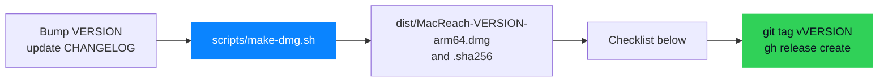
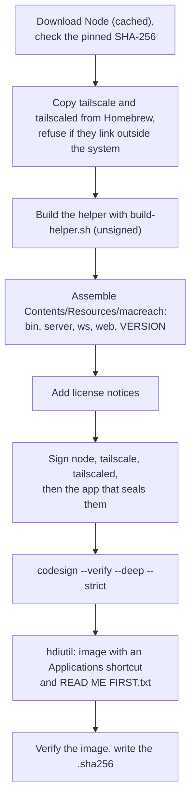

# Releasing MacReach

How the disk image is built and what to check before it goes out.



## Build the disk image

```sh
brew install --formula tailscale      # source of the bundled Tailscale binaries (once)
scripts/make-dmg.sh                   # -> dist/MacReach-<version>-arm64.dmg and .sha256
```

The version comes from the `VERSION` file and ends up in the app's `Info.plist`, the menu and `macreach info`.

What the script does, in order:



| Item | Detail |
| --- | --- |
| Node | Pinned in `scripts/make-dmg.sh` as `NODE_VERSION` and `NODE_SHA256`. Update both together. It must stay at **24.7 or newer** (`crypto.argon2`). |
| Tailscale | Copied from Homebrew after an `otool -L` check that it depends only on system libraries. |
| Size | About 54 MB download, about 157 MB installed. |
| Signing | Inner programs are signed one by one, then the app. No hardened runtime (the app is not notarized and Node needs JIT). |
| First-run note | `scripts/dmg-readme.txt` becomes **READ ME FIRST.txt** in the image. |

## Before the first public release

- [ ] **Back up the signing key** (next section). Do this before anyone else installs the app.
- [ ] **LICENSE:** add one. The repository has none, which means all rights are reserved and nobody may legally reuse the code. Choosing a license is a decision for the owner.
- [ ] **Personal details:** `git grep -nIiE "<your name>|<your tailnet name>|/Users/"` and check the history too (`git log --all -S"<string>"`). Screenshots in `docs/images/` use placeholders; check new ones the same way.
- [ ] **Repository visibility:** a private repository's release files are only downloadable by you. Making it public, or publishing releases from a separate public repository, is the owner's call.
- [ ] **Try it on a second macOS user account or a virtual machine:** a fresh first run (Open Anyway, permissions, password, Tailscale), then uninstall from the menu and an update-in-place.
- [ ] `cd server && node --test test/*.mjs` is green.
- [ ] The tag matches the commit you built from, and the release notes match [CHANGELOG.md](../CHANGELOG.md).

## The signing key

Everything is signed with a self-made certificate kept in `~/Library/Application Support/MacReach/signing` (valid until 2036). macOS ties its Screen Recording and Accessibility grants to that identity, so **if the key is lost, every user must grant them again after the next update**.

```sh
scripts/backup-signing-key.sh ~/Safe/MacReach-signing-backup.enc    # asks for a passphrase in your Terminal
```

Keep the backup **off this Mac** (a password manager attachment or an encrypted USB stick), never in git. The script refuses to write inside the repository. To restore on a new Mac:

```sh
mkdir -p "$HOME/Library/Application Support/MacReach"
openssl enc -d -aes-256-cbc -pbkdf2 -iter 600000 -in MacReach-signing-backup.enc | tar -xzf - -C "$HOME/Library/Application Support/MacReach"
```

## What the image does not do

- **Apple Silicon only.** The helper, Node and Tailscale in the image are arm64. Intel Macs can still build from source (`./install.sh`).
- **No notarization** (it needs a paid Apple developer account), so users go through System Settings > Privacy & Security > **Open Anyway** once.
- **No auto-update.** Users download the new image, drag it over the old app and open it once.
- **Firewall prompt.** With the macOS firewall on, the first start can ask whether `tailscaled` may accept incoming connections. Allow it. If it is denied, Tailscale still works through its relay servers, only slower.

## Publishing

```sh
git tag v<version> && git push origin v<version>
gh release create v<version> dist/MacReach-<version>-arm64.dmg dist/MacReach-<version>-arm64.dmg.sha256 --notes-file <notes.md>
```

Say what was tested and what was not (for example: a first launch on a Mac that never had MacReach). The 1.0.0 notes are a good template.
