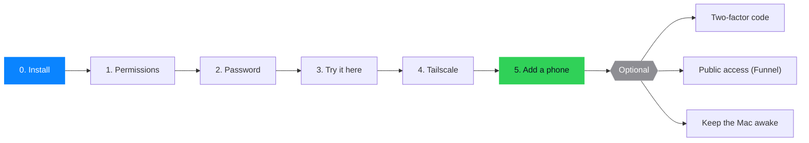
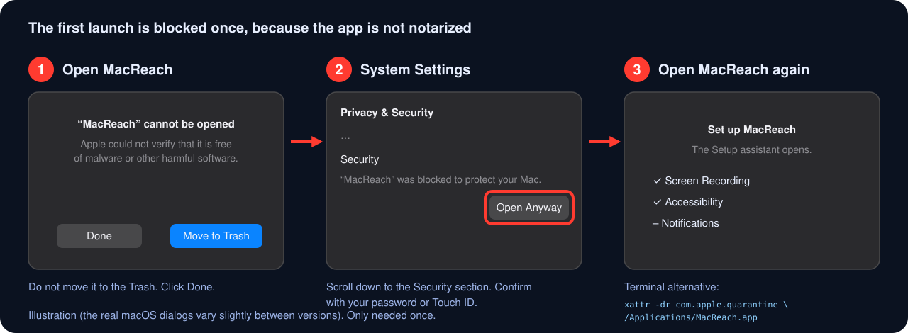
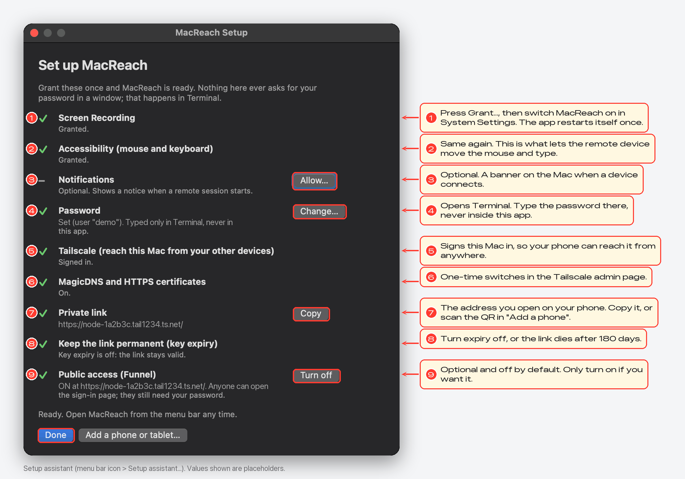
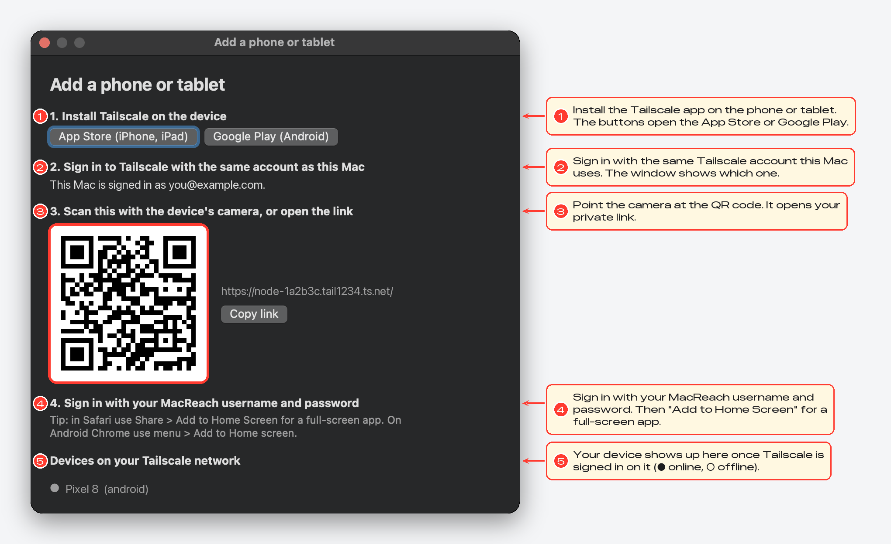
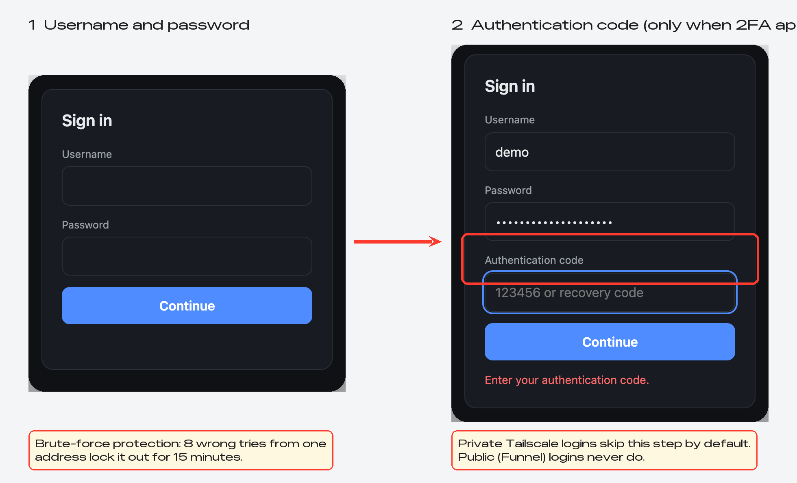

# MacReach setup guide

About 10 minutes. Each step ends with a **Check** so you know it worked before you move on.



Commands below are typed in Terminal. If `macreach` is "command not found", add `~/.local/bin` to your PATH:

```sh
echo 'export PATH="$HOME/.local/bin:$PATH"' >> ~/.zshrc && source ~/.zshrc
```

## 0. Install

**Disk image (most people).** Follow [Install in the README](../README.md#option-a-the-disk-image-no-developer-tools): drag the app to Applications, get past the one-time macOS block with **Open Anyway**, and the Setup assistant opens. Node and Tailscale are inside the app, so skip the rest of this step. The `macreach` command appears in `~/.local/bin` after the first launch.

<p align="center">
  
</p>

**From source (also Intel Macs).** You need macOS 14+, Xcode Command Line Tools with Swift 6, and Node.js **24.7 or newer**.

```sh
git clone https://github.com/VarunMatta5625/macreach.git
cd macreach
./install.sh
```

`install.sh` checks macOS, Swift and Node, installs `ws` and Tailscale (with Homebrew), builds and signs the app, starts the background jobs and opens the Setup assistant. Safe to re-run. `./install.sh --no-tailscale` skips Tailscale.

> [!TIP]
> Copying the folder to a second Mac works the same way: AirDrop, USB or `git clone`, then `./install.sh`.

**Check:** a monitor icon is in your menu bar and the **MacReach Setup** window is open.

## 1. Grant the two macOS permissions

<p align="center">
  
</p>

1. In the Setup assistant press **Grant…** next to **Screen Recording**. System Settings opens. Switch **MacReach** on.
2. Do the same for **Accessibility** (this lets the remote device move the mouse and type).
3. Optionally press **Allow…** next to **Notifications** to get a banner when a device connects.

The assistant ticks each row live. When Screen Recording is newly granted, the app restarts itself once so the grant takes effect. No menu bar? Use `macreach grant`, approve in System Settings, then `macreach restart`.

**Check:** `macreach doctor` shows both permissions as `[ ok ]`.

> [!TIP]
> You can redo or review any step later: menu bar icon > **Setup assistant…**. The same rows are in **Settings…**. Deep links: `open macreach://setup`, `macreach://settings`, `macreach://add-device`.

## 2. Set your password

Press **Set password…** next to **Password** in the assistant (the button reads **Change…** once a password exists), or run:

```sh
macreach set-password
```

You are asked for a username (first time only), then the password twice, **with no echo**. Use a passphrase of at least 12 characters. It is stored only as an Argon2id hash. Nothing in MacReach ever asks for it in a window: it is only typed in Terminal.

**Check:** `macreach status` says `Password    : set`.

## 3. Try it on this Mac

Open <http://localhost:7878/> and sign in. You see your own screen, but mouse and keyboard are **off** there: your real mouse and the remote one would fight. (The page offers "Turn input on anyway" if you really want it.) Test control from your phone instead.

If you have extra monitors, a monitor button appears in the toolbar ("Mac" is the built-in display, then 1, 2…). Your choice is remembered, unplugging a display falls back to the built-in one, and plugging it back restores it.

**Check:** the page shows a live picture of your Mac.

## 4. Tailscale: reach the Mac from your other devices

Tailscale is a free service that makes a private network between your devices. MacReach uses it so your phone can reach the Mac without opening any port.

1. **On the Mac:** in the assistant press **Sign in…** next to Tailscale, or run `macreach access login`. Approve the link that opens. The machine gets a random neutral name like `node-1a2b3c` (it appears in public certificate logs, so avoid a revealing name; `macreach access login <name>` overrides it).
2. **Once per Tailscale account:** open the [Tailscale admin DNS page](https://login.tailscale.com/admin/dns) and turn on **MagicDNS** and **HTTPS Certificates**.
3. **On the Mac:** press **Set up** next to Private link, or run `macreach access serve`. It prints your private address, like `https://node-1a2b3c.tail1234.ts.net/`.
4. **Turn off key expiry:** open [Machines](https://login.tailscale.com/admin/machines), open this Mac's `⋯` menu, choose **Disable key expiry**. Without this, Tailscale signs the Mac out after 180 days and the link stops working.

**Check:** `macreach doctor` shows `tailscale`, `private URL (tailnet)` and `tailscale key expiry` as `[ ok ]`.

> [!NOTE]
> The Mac itself cannot open its own tailnet address: the Tailscale daemon runs without root, so the Mac has no route to it. Test the private link from another device.

## 5. Add a phone or tablet

Menu bar icon > **Add phone or tablet…** (also in Settings and at the end of the assistant).

<p align="center">
  
</p>

1. Install the **Tailscale** app on the device (App Store or Google Play buttons are in the window).
2. Sign in to Tailscale with **the same account as this Mac**.
3. Scan the QR code with the camera (or press **Copy link**). It opens your private link.
4. Sign in with your MacReach username and password.

For a full-screen app, use Safari's **Share > Add to Home Screen** (iOS) or Chrome's **menu > Add to Home screen** (Android).

If something is missing (Tailscale sign-in, HTTPS certificates, private link, password) the window says what to do first. The device list shows when your phone has joined.

<p align="center">
  
</p>

**Check:** you see your Mac's screen on the phone and the menu bar icon turns red with **In use**.

---

## Optional: two-factor code

```sh
macreach totp enable
```

It shows a secret and a link for your authenticator app, plus **10 one-time recovery codes** (save them: they are shown only once), then asks for a code to confirm. The login page then asks for a 6-digit code.

By default the code is asked for **public (Funnel) and local logins, not for private Tailscale logins**, because a private login already comes from one of your own signed-in devices. To ask for it everywhere: `macreach config set totpOnTailnet true`. Turn it off: `macreach totp disable`. Details: [SECURITY.md](../SECURITY.md#two-factor-code-and-the-private-link).

## Optional: public access (Funnel)

Funnel lets **any browser on the internet** reach your sign-in page, without Tailscale on that device. It is off by default.

1. In **Setup** or **Settings**, press **Turn on…** next to Public access (or run `macreach access funnel`).
2. Type `go public` to confirm. MacReach refuses if no password is set.
3. The first time, Tailscale may say your account has not allowed Funnel yet. The app shows a link: open it, approve, then press **Turn on…** again.
4. Run `macreach doctor` to confirm the public URL answers and that client IPs are visible (that decides whether the per-address rate limit works behind Funnel).

Turn it off at any time: **Turn off** in Setup or Settings, **Turn public access off** in the menu bar menu, or `macreach access funnel off`.

## Optional: keep the Mac reachable

A sleeping Mac cannot be reached. While someone is connected, MacReach holds the Mac awake itself. To stop the Mac from sleeping on power when nobody is connected:

```sh
sudo pmset -c sleep 0
```

(The display may still sleep.) A closed lid, a sleeping Mac, the login window and a locked screen cannot be controlled remotely. That is a macOS limit. `macreach doctor` reports the current setting.

---

## Starting and stopping

| Want to | Do |
| --- | --- |
| Pause or resume remote access | menu bar icon > **Pause remote access**, or `macreach access pause` / `resume` |
| End the current session | menu bar icon > **Disconnect session**, or `macreach kick` |
| Stop MacReach until next login | menu bar icon > **Quit MacReach…**, or `macreach stop` |
| Don't start at login | **Settings…** > untick **Start MacReach when I log in**, or `macreach autostart off` |
| Remove completely | menu bar icon > **Uninstall MacReach…** (disk image), or `macreach uninstall` (keeps your data) / `macreach uninstall --purge` (deletes it) |

## Keep the link the same

Your private link (`https://node-….ts.net/`) does not change by itself. It changes only if you remove or rename this Mac in the Tailscale admin console, or run `macreach uninstall --purge`. The one thing that breaks it is Tailscale's key expiry (see step 4).

## Day to day

| Want to | Command |
| --- | --- |
| See the access card (URLs and controls) | `macreach card` |
| Pause everything, reversible | `macreach access pause` / `macreach access resume` |
| Kill all remote access | `macreach access kill` |
| Who is connected | `macreach status`, `macreach audit` |
| Disconnect them / sign out all devices | `macreach kick` / `macreach revoke-all` |
| Health check | `macreach doctor` |
| Read logs | `macreach logs` (server) or `macreach logs helper` |

Logs rotate automatically (over 5 MB, checked hourly). After updating a source checkout, run `./install.sh` (or `scripts/build-helper.sh && macreach install`) to redeploy.

## Troubleshooting

| You see | Do this |
| --- | --- |
| Remote screen is black, or "Screen Recording permission needed" | Approve the permission on the Mac (System Settings > Privacy & Security > Screen & System Audio Recording). macOS re-asks every so often. |
| "Mac is locked" | Unlock the Mac locally. Remote control cannot unlock it. |
| "Mac agent not running" | It restarts by itself. If it persists: `macreach restart`, then `macreach logs helper`. |
| Mouse and keyboard do nothing | Accessibility is not granted, or you are viewing the Mac from itself (input is off there on purpose). |
| Scrolling goes the wrong way | Settings sheet > **Invert scroll on the Mac**. |
| "Too many attempts" on the login page | Wait for the countdown. Eight wrong tries lock an address for 15 minutes. |
| The link stopped working after months | Tailscale key expiry. Disable it (step 4) and run `macreach access login` again. |
| Anything else | `macreach doctor`. Every red line has a fix next to it. |

## Known limits

- **Locked screen, closed lid, sleep, login window:** not controllable remotely (macOS limit).
- **Periodic Screen Recording re-approval:** since macOS Sequoia, macOS re-asks about every month whether an app may keep recording the screen. The Apple entitlement that avoids this is only granted to approved VNC-type apps, so a personal build cannot use it. Behaviour on macOS versions newer than Sequoia has not been confirmed.
- **Safari:** tested with Playwright's WebKit (iPhone 15 and iPad Pro 11 profiles) and with Chrome and Android Chrome, not on real iOS or iPadOS devices. Pencil hover and the iOS keyboard paths need a real-device check.
