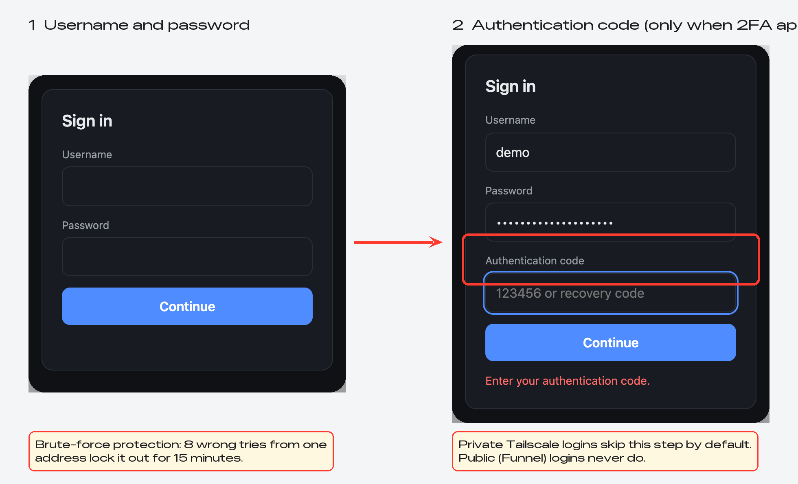
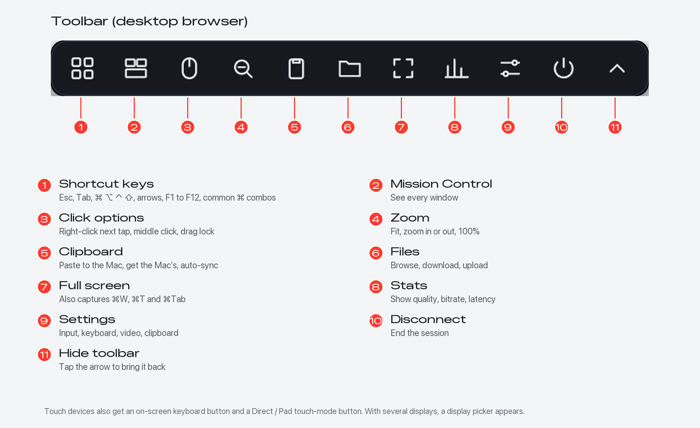
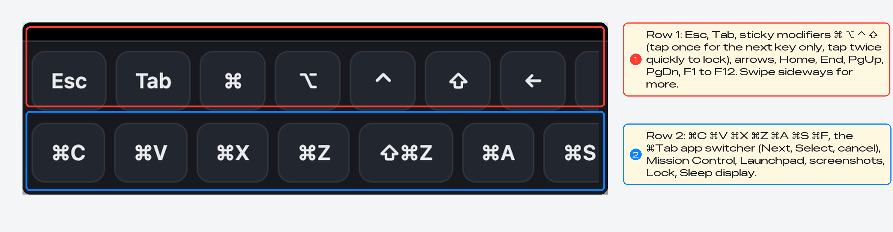
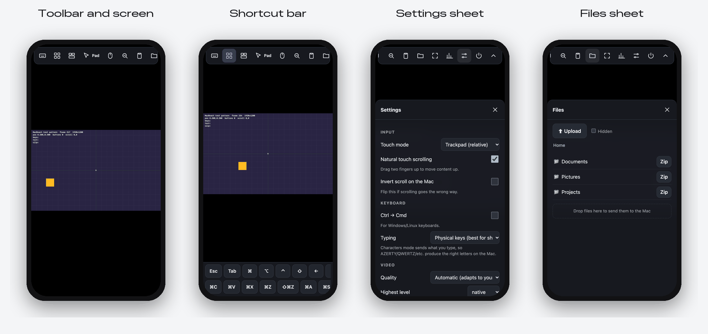
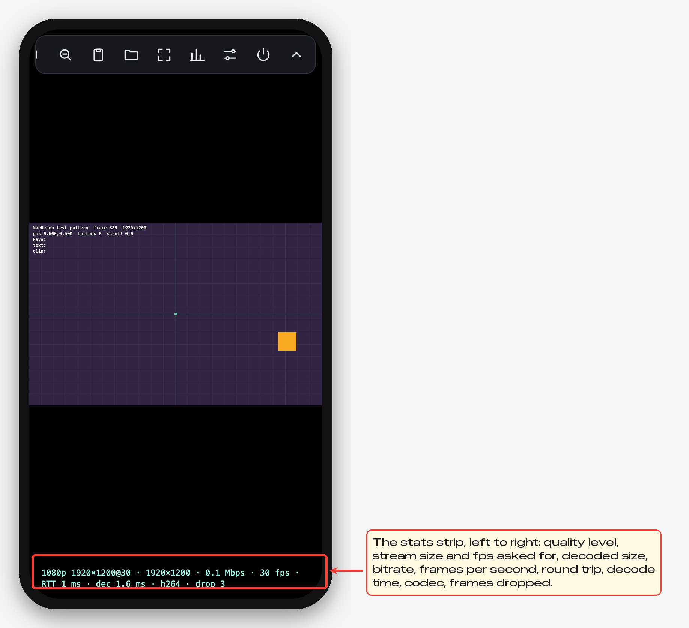
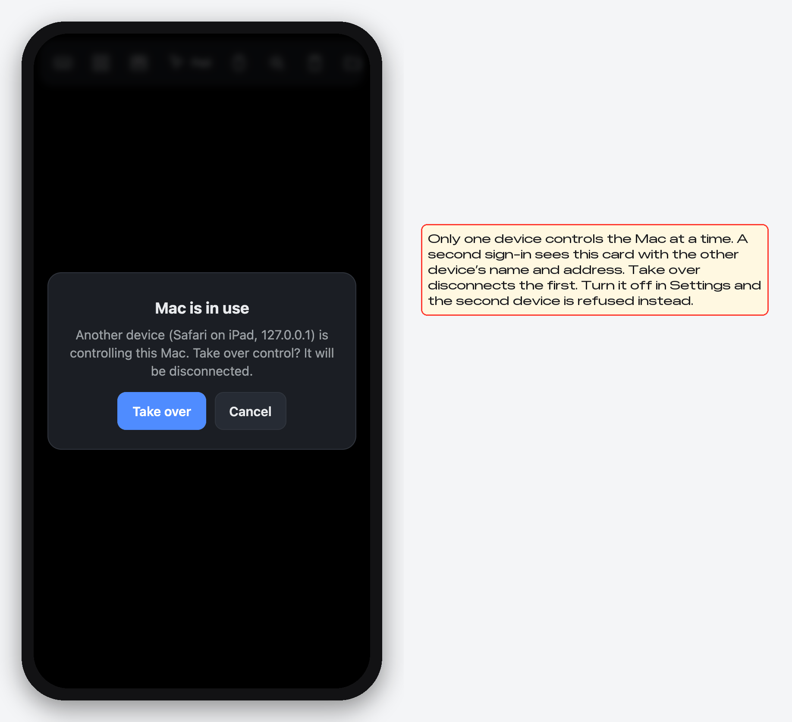
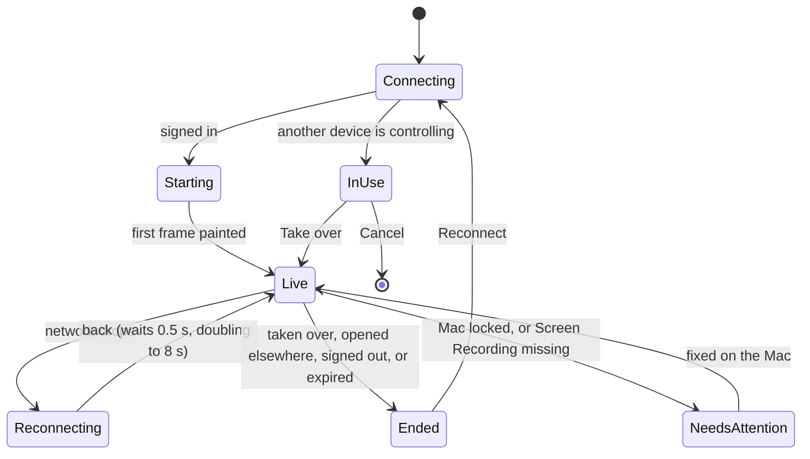
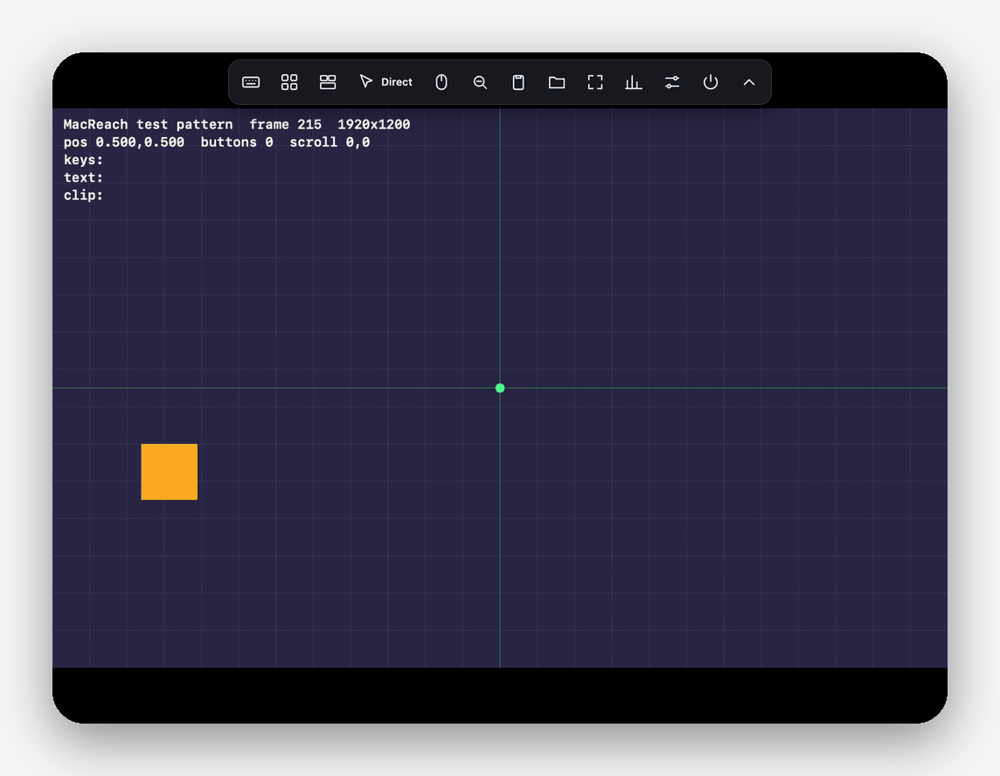
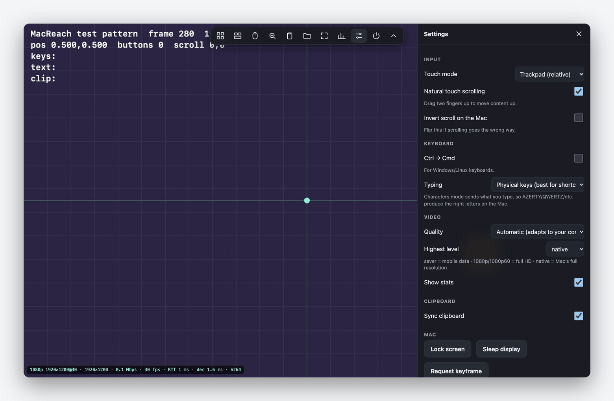

# The web client

The browser side of MacReach: vanilla ES modules, no build step, served by the Node server from `web/`. Everything on this page is about what you see and touch in the browser.

> [!NOTE]
> The screens below show MacReach's built-in **test pattern** (a grid, a crosshair and a moving square) so that no real desktop appears in the documentation. On your device you see your Mac.

## Sign in

  

1. Enter your MacReach username and password.
2. If two-factor is on and this login has to prove itself, a code field appears. Enter the 6-digit code **or** one of your recovery codes (each works once).
3. If the server allows "Remember this device", a checkbox appears.

After 8 wrong tries from one address, that address waits 15 minutes. The page shows a countdown.

## The toolbar

  

The toolbar floats at the top. The last button hides it; a small arrow brings it back. On touch devices it scrolls sideways and has two extra buttons: **on-screen keyboard** and **touch mode**.

## Controlling the Mac

### With a mouse or trackpad (desktop browsers)

The pointer is absolute: where you point in the page is where the Mac's pointer goes. Double and triple clicks are recognised (450 ms apart, within 6 px). Mouse wheel and two-finger scroll are sent as scrolls. **Shift + wheel** scrolls sideways. **Ctrl + wheel** (and a trackpad pinch) zooms your local view, not the Mac.

### With touch

There are two modes. Phones default to **Pad**; iPads default to **Direct**. Switch from the toolbar or the settings sheet.

| Gesture | Direct (touchscreen) | Pad (relative cursor) |
| --- | --- | --- |
| One-finger drag | Moves the pointer to your finger (no button pressed); pans the view when you are zoomed in | Moves the cursor relative to where it is, faster when you swipe faster |
| Tap | Click at the finger | Click at the cursor |
| Double tap | Double-click | Double-click |
| Hold about half a second, then release | Right-click | n/a |
| Hold, then drag | Drag | Tap and immediately touch again, then drag |
| Two-finger tap | Right-click | Right-click |
| Two-finger drag | Scroll, with momentum after a flick | Scroll, with momentum after a flick |
| Pinch | Zoom your local view (1× to 8×) | Zoom your local view |
| Three or more fingers | Ignored (iPadOS reserves them) | Ignored |

Apple Pencil and other pens are always a precise absolute pointer. The **Click options** button gives you right-click or middle-click for the next tap, a drag lock (hold the button while you move) and a double-click.

> [!TIP]
> On a slow connection the Mac's cursor in the video trails your pointer by a full round trip. When the smoothed round trip exceeds 120 ms the browser draws its own pointer so it moves instantly. It switches back below 70 ms.

## Typing

| Way to type | How it works |
| --- | --- |
| **Physical keyboard** | Keys are sent by `KeyboardEvent.code`, so shortcuts and games behave like the real key. Choose **Characters** in Settings if you use AZERTY, QWERTZ or another non-US layout: it sends what you type, so you get the right letters on the Mac. |
| **On-screen keyboard** button | Opens your phone's keyboard, dictation and emoji. A hidden text field is compared with what it held before and turned into Backspaces plus text, which makes autocorrect and Gboard behave. |
| **Shortcut bar** | Esc, Tab, sticky modifiers, arrows, F1 to F12, and the common ⌘ combinations. |

  

- **Sticky modifiers** ⌘ ⌥ ⌃ ⇧: tap once to apply to the next key only; tap twice within 0.4 s to lock until you tap again.
- **⌘Tab** starts the app switcher. **Next ⇥** cycles, **✓ Select** picks, the cancel button backs out. If you do nothing for 7 s the held ⌘ is released.
- **Ctrl → Cmd** in Settings swaps Ctrl for ⌘ for Windows and Linux keyboards (suggested automatically on those systems).
- In **full screen** on Chromium, the browser captures the keyboard, so ⌘W, ⌘T and ⌘Tab go to the Mac instead of your browser.

## Clipboard and files

- **Clipboard** menu: paste this device's clipboard to the Mac, get the Mac's clipboard here, or turn auto-sync on and off. Text and images are supported. iOS only lets a page read the clipboard after a tap, so "get the Mac's" needs a tap there.
- **Files** sheet: browse folders under the allowed roots (your home folder by default), download a file or a whole folder as a zip, and upload by pressing **Upload** or dropping files in. Uploads land in `~/Downloads/MacReach` on the Mac (a name that already exists gets ` (1)`, ` (2)`… added). Large files stream over plain HTTP, not through the video connection.

  

## Settings sheet

| Section | Setting | What it does |
| --- | --- | --- |
| Input | Touch mode | Direct or Pad |
| Input | Natural touch scrolling | Two fingers up moves content up |
| Input | Invert scroll on the Mac | Flip this if scrolling goes the wrong way |
| Keyboard | Ctrl → Cmd | For Windows and Linux keyboards |
| Keyboard | Typing | Physical keys, or Characters for non-US layouts |
| Video | Quality | Automatic, or Fixed at a chosen level |
| Video | Highest level / Level | One of `saver`, `low`, `medium`, `1080p`, `1080p60`, `native` |
| Video | Display | Which Mac display (only with several) |
| Video | Show stats | The strip described below |
| Clipboard | Sync clipboard | Auto-sync on or off |
| Mac | Lock screen, Sleep display, Request keyframe | One-tap actions |
| Account | Sign out | Ends this browser's login |

Settings are per device and stored in the browser. Only values you change are saved, so the device-based defaults (iPad = Direct, phone = Pad, Windows = Ctrl → Cmd) keep adapting until you choose.

## Stats

Turn on **Show stats** (or the bar-chart button) for a strip at the bottom of the screen:

  

## Taking over, and other states

Only one device controls the Mac at a time. These are the cards you can meet:

  

| Card | Meaning |
| --- | --- |
| **Mac is in use** | Another device controls the Mac. **Take over** disconnects it. If takeover is turned off in the Mac's Settings you can only try again. |
| **Control was taken over** | Another device took control from you. |
| **Opened elsewhere** | The same login was opened in another tab or window. |
| **Session ended** | You signed out, or the Mac's owner pressed Disconnect. |
| **Screen Recording permission needed** | Approve it on the Mac. Streaming starts by itself. |
| **Mac is locked** | Unlock it at the Mac. Remote control cannot. |
| **Mac agent not running** | The helper restarts by itself. If it persists, run `macreach doctor` on the Mac. |

A session expires after 30 minutes without input (change it in the Mac's Settings) or 12 hours in total, and you are sent back to the sign-in page.

## On a tablet or a desktop

  

  

## Install it as an app

On iOS use **Share > Add to Home Screen**. On Android Chrome use **menu > Add to Home screen**. The app opens full screen. It appears as **Remote**, a neutral name on purpose.

## Where the numbers live

All gesture and timing thresholds are in one file, `web/app/js/config.js` (tap length, double-tap window, long-press time, momentum, reconnect backoff and more). Change them there.
